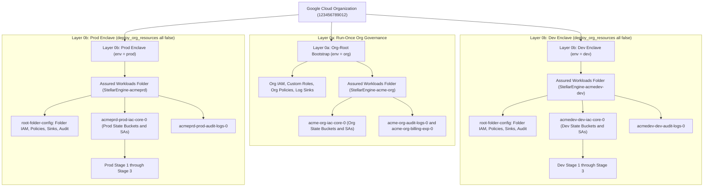

# Multi-enclave single-organization topology

Deploy multiple isolated Stellar Engine enclaves inside a single Google Cloud organization without collapsing non-production and production trust boundaries or introducing circular dependencies between Stage 0 and Stage 1.

<!-- BEGIN TOC -->
- [1. Architecture overview](#1-architecture-overview)
- [2. Trust boundaries](#2-trust-boundaries)
- [3. Naming and prefix rules](#3-naming-and-prefix-rules)
- [4. Org-root bootstrap configuration](#4-org-root-bootstrap-configuration)
- [5. Enclave bootstrap configuration](#5-enclave-bootstrap-configuration)
  - [Required Layer 0a / out-of-band handoff grants](#required-layer-0a--out-of-band-handoff-grants)
- [6. Deployment order](#6-deployment-order)
<!-- END TOC -->

## 1. Architecture overview

A single Google Cloud organization can host separate development, staging, and production landing zones when you split Stage 0 into two independent layers:

- Run one organization-root bootstrap instance, layer 0a, to own organization-wide IAM, custom roles, organization policies, organization logging settings, organization log sinks, audit configuration, billing export, and Workforce Identity pools.
- Run one folder-scoped enclave bootstrap instance, layer 0b, for each isolated enclave such as `dev` and `prod` with every flag in the `deploy_org_resources` variable set to `false`.

Layer 0a holds zero downstream enclave dependencies, and you do not run Stage 1 under layer 0a. Each layer 0b instance provisions its own Assured Workloads folder, automation project, Terraform state buckets, automation service accounts, KMS keys, and folder-scoped audit log project, then feeds its own independent Stage 1 through Stage 3 pipeline.



## 2. Trust boundaries

Separating layer 0a from each layer 0b enclave enforces hard blast-radius boundaries across environments:

- Enclave Stage 0 and Stage 1 deployments create zero organization-level IAM bindings because `module.organization` skips every IAM binding, `module.root-folder-config` and `module.root-folder-iam` strip organization-only roles, and read-only service accounts omit `iam_organization_roles` when `deploy_org_resources.iam` is `false`. Provision the targeted billing, workload refresh, organization policy, and Access Context Manager handoff grants documented in [Required Layer 0a / out-of-band handoff grants](#required-layer-0a--out-of-band-handoff-grants).
- Enclave Terraform state buckets live inside each enclave automation project under separate KMS keys, so non-production pipelines hold zero read or write access to production or organization-root state buckets.
- Folder-level IAM, organization policies, essential contacts, log sinks, and audit logging attach strictly to the enclave Assured Workloads folder through `module.root-folder-config` and `google_folder_iam_audit_config.folder`.
- Each enclave creates an independent Assured Workloads folder, allowing distinct compliance regimes, regional boundaries, or promotion cadences per enclave.
- Layer 0a never reads outputs from any enclave Stage 1 deployment, eliminating circular dependencies between Stage 0 and Stage 1.

## 3. Naming and prefix rules

Stage 0 combines the `prefix` and `env` variables into `local.prefix` as `<prefix>-<env>` for globally unique resources, including automation projects, audit logging projects, Cloud Storage state buckets, service account emails, KMS bindings, and Workload Identity pools.

- Leaving `env` unset defaults to `prod` and preserves existing `<prefix>-prod-*` resource names and the `StellarEngine-<prefix>` Assured Workloads folder display name.
- Setting a non-production `env` value such as `org` or `dev` sets the Assured Workloads folder display name to `StellarEngine-<prefix>-<env>` so sibling enclave folders under the same organization never collide.
- The `env` variable accepts 1 to 6 lowercase alphanumeric characters or interior hyphens, starting with a letter and ending with a letter or digit. Combined with the 7-character `prefix` limit, every Stage 0 project ID, service account ID, and folder display name stays within the 30-character Google Cloud limit.
- Downstream Stage 1 through Stage 3 modules derive several state bucket and project names directly from `prefix`. Assign each enclave a distinct short `prefix` value such as `acmedev` and `acmeprd` alongside `env` when you deploy full Stage 1 through Stage 3 stacks in parallel inside one organization.

The `stellar-engine preflight` CLI currently assumes `env = "prod"`, while `cli/src/stellar_engine/naming.py` supports the parameterized `env` helper.

## 4. Org-root bootstrap configuration

Configure layer 0a with the default `deploy_org_resources` behavior so every organization-level control deploys once and remains owned by a single state file. Set `env = "org"` so layer 0a projects and buckets never collide with production or non-production enclaves.

```hcl
# Layer 0a: fast/stages-aw/0-bootstrap/terraform.tfvars
prefix = "acme"
env    = "org"

organization = {
  id          = 123456789012
  domain      = "example.com"
  customer_id = "C00000000"
}

billing_account = {
  id           = "000000-AAAAAA-000000"
  is_org_level = true
  no_iam       = false
}

assured_workloads = {
  regime   = "IL5"
  location = "us-east4"
}

regions = {
  primary = "us-east4"
}

bootstrap_project    = "org-bootstrap-project"
alert_email          = "org-alerts@example.com"
kms_protection_level = "HSM"
outputs_location     = "~/fast-config-org"
```

Keep all `deploy_org_resources` flags at their `true` defaults in layer 0a so organization IAM, custom roles, custom organization policy constraints, organization logging settings, organization log sinks, and organization audit logging are managed in one place. Set `assured_workloads.regime = "COMPLIANCE_REGIME_UNSPECIFIED"` if your organization prefers a standard management folder instead of an Assured Workloads folder for layer 0a.

## 5. Enclave bootstrap configuration

Configure each layer 0b enclave in its own working directory or repository with a dedicated `outputs_location` directory, a unique `env` token, and all seven `deploy_org_resources` flags disabled. Set `billing_account.no_iam = true` when layer 0a manages organization-level billing IAM and the shared billing export project.

```hcl
# Layer 0b (Dev Enclave): fast/stages-aw/0-bootstrap/terraform.tfvars
prefix = "acmedev"
env    = "dev"

organization = {
  id          = 123456789012
  domain      = "example.com"
  customer_id = "C00000000"
}

billing_account = {
  id           = "000000-AAAAAA-000000"
  is_org_level = true
  no_iam       = true
}

deploy_org_resources = {
  audit_config            = false
  custom_roles            = false
  iam                     = false
  logging_settings        = false
  logging_sinks           = false
  org_policies            = false
  workforce_identity_pool = false
}

assured_workloads = {
  regime   = "IL5"
  location = "us-east4"
}

regions = {
  primary = "us-east4"
}

fast_features = {
  envs = true
}

bootstrap_project    = "dev-bootstrap-project"
alert_email          = "dev-alerts@example.com"
kms_protection_level = "HSM"
outputs_location     = "~/fast-config-dev"
```

Repeat the same layer 0b configuration for the production enclave with `prefix = "acmeprd"`, `env = "prod"`, a separate `bootstrap_project` value, and `outputs_location = "~/fast-config-prod"`.

### Required Layer 0a / out-of-band handoff grants

When `billing_account.no_iam` is `true` and all seven `deploy_org_resources` flags are `false`, Stage 0 (`module.root-folder-config`) and Stage 1 (`module.root-folder-iam`) strip organization-only IAM roles so enclave plans never mutate organization IAM directly. Provision the following targeted handoff grants from layer 0a (or out of band) so layer 0b Pass 2, split CI/CD `plan` jobs, Stage 1, and Stage 3 succeed without granting broad organization administrator roles:

- Grant `roles/billing.user` on the billing account to the layer 0b automation service accounts (`<prefix>-<env>-bootstrap-0`, `<prefix>-<env>-resman-0`, and downstream Stage 1 through Stage 3 project-creating service accounts), or configure the `billing_override` variable, so billing-linked project creation succeeds.
- Grant `roles/assuredworkloads.reader` at the organization scope to `<prefix>-<env>-bootstrap-0` (or execute workload updates as an Assured Workloads administrator) so Pass 2 and subsequent Stage 0 runs can refresh `google_assured_workloads_workload.primary[0]`.
- Grant `roles/orgpolicy.policyAdmin` at the organization scope to `<prefix>-<env>-bootstrap-0` and `<prefix>-<env>-resman-0` because Organization Policy v2 evaluates `roles/orgpolicy.policyAdmin` only at the organization resource even when Stage 0 and Stage 1 manage folder-scoped and project-scoped policies inside the enclave.
- Grant `roles/orgpolicy.policyViewer` (or layer 0a's `organizations/<org_id>/roles/organizationAdminViewer` custom role) at the organization scope to the read-only `<prefix>-<env>-bootstrap-0r` and `<prefix>-<env>-resman-0r` service accounts so split CI/CD `plan` jobs can read inherited policy state without `403 PERMISSION_DENIED`.
- Grant `roles/accesscontextmanager.policyAdmin` at the organization scope (or bind it on a dedicated scoped `accessPolicies/<id>` policy passed via `vpc_sc.access_policy` in Stage 3 alongside folder-scoped `vpc_sc.resource_discovery.parent` and `vpc_sc.project_id_search_scope`) to the enclave Stage 3 security service account `<prefix>-security-0` (and `<prefix>-<env>-resman-0` if Stage 1 manages organization-scoped Access Context Manager bindings) when layer 0b manages a VPC Service Controls perimeter.

Add the organization-scoped Stage 0 and Stage 1 handoff bindings to layer 0a's `terraform.tfvars` after layer 0b Pass 1 creates the enclave automation service accounts, and uncomment the Stage 3 `security-0` binding after enclave Stage 1 creates `module.branch-security-sa` (unless you delegate a scoped `accessPolicies/<id>` policy directly):

```hcl
# Layer 0a: fast/stages-aw/0-bootstrap/terraform.tfvars
iam_bindings_additive = {
  acmedev_bootstrap_aw_reader = {
    member = "serviceAccount:acmedev-dev-bootstrap-0@acmedev-dev-iac-core-0.iam.gserviceaccount.com"
    role   = "roles/assuredworkloads.reader"
  }
  acmedev_bootstrap_orgpolicy_admin = {
    member = "serviceAccount:acmedev-dev-bootstrap-0@acmedev-dev-iac-core-0.iam.gserviceaccount.com"
    role   = "roles/orgpolicy.policyAdmin"
  }
  acmedev_resman_orgpolicy_admin = {
    member = "serviceAccount:acmedev-dev-resman-0@acmedev-dev-iac-core-0.iam.gserviceaccount.com"
    role   = "roles/orgpolicy.policyAdmin"
  }
  acmedev_bootstrap_r_orgpolicy_viewer = {
    member = "serviceAccount:acmedev-dev-bootstrap-0r@acmedev-dev-iac-core-0.iam.gserviceaccount.com"
    role   = "roles/orgpolicy.policyViewer"
  }
  acmedev_resman_r_orgpolicy_viewer = {
    member = "serviceAccount:acmedev-dev-resman-0r@acmedev-dev-iac-core-0.iam.gserviceaccount.com"
    role   = "roles/orgpolicy.policyViewer"
  }
  # Enable after acmedev Stage 1 creates acmedev-security-0 when managing an
  # org-level VPC Service Controls policy instead of a scoped accessPolicies/<id>:
  # acmedev_sec_acm_admin = {
  #   member = "serviceAccount:acmedev-security-0@acmedev-dev-iac-core-0.iam.gserviceaccount.com"
  #   role   = "roles/accesscontextmanager.policyAdmin"
  # }
}
```

## 6. Deployment order

Follow this sequence to stand up the organization root and each isolated enclave without permission or state conflicts:

1. Deploy layer 0a using the standard two-pass bootstrap flow in the [Detailed Deployment Guide](ddg.md) and migrate layer 0a state to its `acme-org-iac-core-bootstrap-0` bucket.
2. Verify that layer 0a created organization logging settings, custom roles, organization policies, and organization audit sinks before provisioning enclaves.
3. Run Pass 1 of each layer 0b enclave (`bootstrap_user` set and all seven `deploy_org_resources` flags set to `false`) to create the enclave Assured Workloads folder, automation project, state buckets, and automation service accounts, then apply the [Required Layer 0a / out-of-band handoff grants](#required-layer-0a--out-of-band-handoff-grants) in layer 0a and on the billing account before running layer 0b Pass 2 and migrating state to `<prefix>-<env>-iac-core-bootstrap-0`.
4. Link each enclave output directory, such as `~/fast-config-dev` or `~/fast-config-prod`, into that enclave's own Stage 1, Stage 2, and Stage 3 runs (granting `roles/accesscontextmanager.policyAdmin` or a scoped `accessPolicies/<id>` binding to `<prefix>-security-0` after Stage 1 when Stage 3 manages VPC Service Controls) so every enclave consumes only its own automation project, service accounts, Assured Workloads folder, and state buckets.
